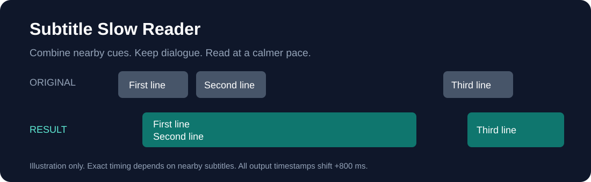
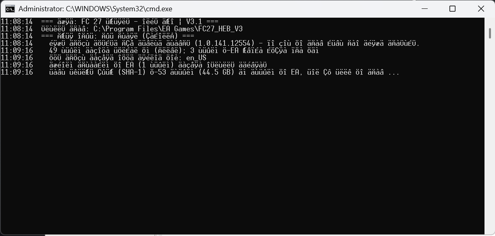
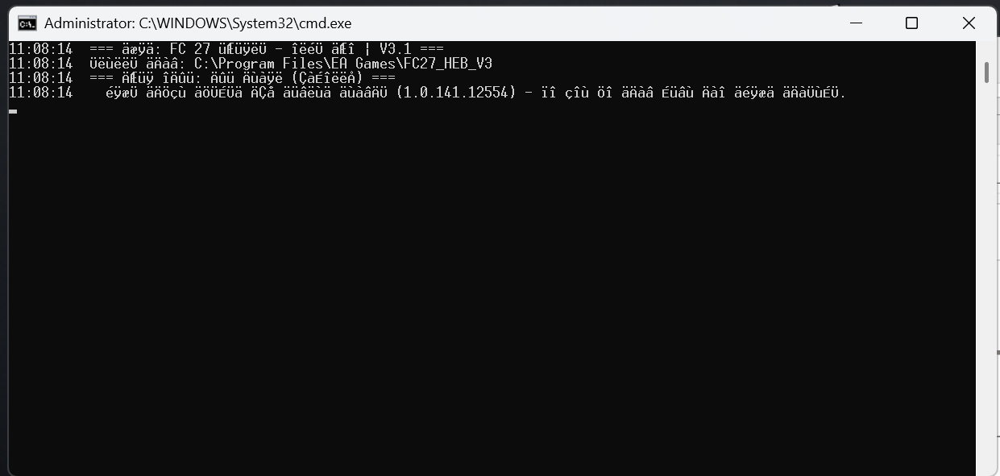

# Subtitle Slow Reader

כלי ל־Windows שנותן יותר זמן לקרוא כתוביות: מאחד חילופי דברים מהירים ומאריך את זמן הצגת הכתוביות. שומר קובץ חדש לצד המקור.



## הורדה והפעלה

1. הורידו את [קובץ ההפעלה](../../raw/refs/heads/main/Subtitle_Slow_Reader.bat), או בחרו **Code → Download ZIP** וחלצו את הקבצים.
2. לחצו פעמיים על `Subtitle_Slow_Reader.bat` ובחרו קובץ SRT אחד או יותר. אפשר גם לגרור קובץ SRT יחיד אל קובץ ההפעלה.
3. התוצאה תישמר ליד המקור בשם שמסתיים ב־`_hold6sec.srt`. אם השם תפוס, נוסף מספר. הקובץ המקורי נשאר ללא שינוי.
4. פתחו את הסרט בנגן ובחרו את קובץ הכתוביות החדש.

דרישות: Windows עם Windows PowerShell 5.1 וסביבת שולחן עבודה. אין צורך בהתקנת חבילות נוספות.

## מה משתנה בכתוביות?

- עד שלוש כתוביות סמוכות מתאחדות לכרטיס, עם עד ארבע שורות טקסט.
- זמן הסיום מתארך בעד **5.2 שניות**, ונעצר לפני הכרטיס הבא.
- זמני ההתחלה והסיום זזים **800 אלפיות השנייה קדימה**.
- הכלי בודק שכל שורות הדיאלוג נשמרו באותו סדר ושאין חפיפה בין כרטיסי הפלט.

הסיומת `hold6sec` מגיעה מהקובץ המקורי; בפועל מדובר בהארכה של 5.2 שניות ובתוספת הזזה של 0.8 שניות.

## דוגמה

בתיקייה `examples` יש כתוביות מקוריות ותוצאה שנוצרה בהרצת הכלי. שתי הכתוביות הראשונות מתאחדות, והשלישית מוצגת בנפרד.

```bat
Subtitle_Slow_Reader.bat "C:\Subtitles\movie.srt"
```

## קידוד ומגבלות

הכלי משמר את בתי הטקסט בקידודים תואמי ASCII, לרבות UTF-8 ו־Windows-1255. נתמך גם UTF-16 עם BOM. קידוד UTF-32 ומבני SRT שאינם נתמכים נדחים. מומלץ לבדוק את התוצאה מול הסרט, במיוחד כשכמה דוברים מופיעים באותו כרטיס.

קובץ ההפעלה מפעיל קוד PowerShell מוטמע עם עקיפת מדיניות הרצה לתהליך הנוכחי בלבד. אין צורך בחיבור לרשת לעיבוד הכתוביות.

## תמונות מהשיחה המקורית

אלה שני הקבצים שצורפו לשיחה המקורית. הם מציגים כלי הקשור ל־FC27, ואינם צילומי מסך של Subtitle Slow Reader.




